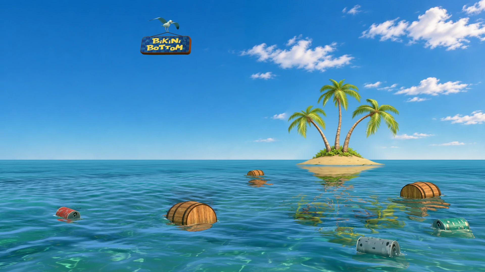
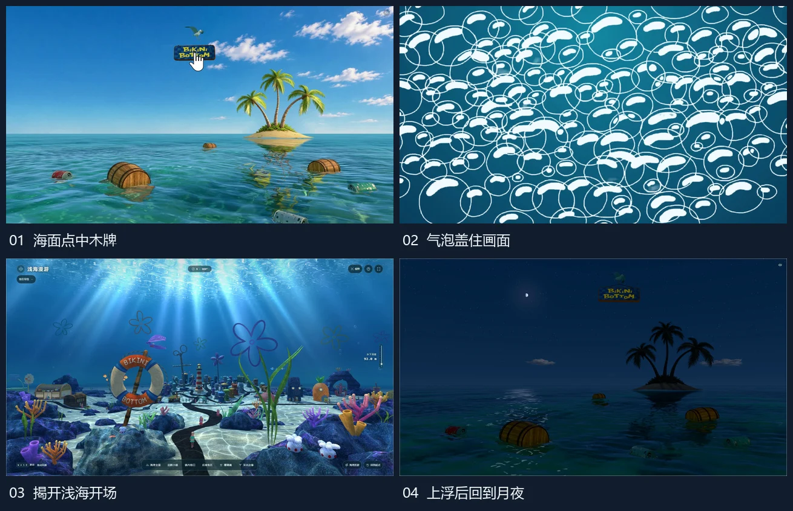
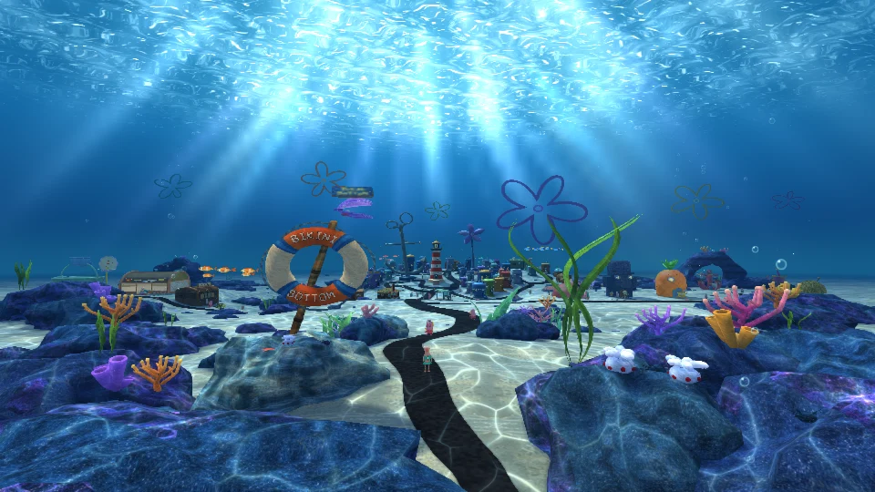

# Bikini Bottom · 海面到浅海

**by [MR.Shawn](https://github.com/ababanabk022-debug)**

等海鸥叼着蓝色木牌飞过。点下木牌，看它落入海里，再穿过一屏气泡，来到水下 92 米的比奇堡。沿珊瑚、街道和灯塔自由游览，最后带着同一块木牌回到海面。



**[下载完整项目](https://github.com/ababanabk022-debug/bikini-bottom-shawn/archive/refs/tags/v1.0.0.zip)** · **[独立项目下载](https://github.com/ababanabk022-debug/bikini-bottom-shawn/releases/tag/v1.0.0)**

## 运行

使用 Node.js 20 或更高版本。解压完整项目，在项目目录运行即可。浏览器需要支持 WebGL 2。

```sh
npm start
```

打开 [合并版](http://127.0.0.1:8846/)。木桶和易拉罐可以拖动，海面底边可调昼夜，右上角可控制环境声。

在浅海拖动屏幕环顾。用 `WASD` 或方向键游动，空格上浮，`C` 下潜，`Shift` 加速。游近落入镇前的木牌并点击，或上浮到水下 50 米，即可返回海面。

## 三个独立项目

| 项目 | 内容 | 单独下载 |
| --- | --- | --- |
| [海面](web/surface/) | 实时风浪、倒影、可拖动浮物和携牌飞行的海鸥 | [surface.zip](https://github.com/ababanabk022-debug/bikini-bottom-shawn/releases/download/v1.0.0/surface.zip) |
| [气泡过场](web/transition/) | 带透明通道的 WebM、低负载版本和独立的原声 AAC 音轨 | [transition.zip](https://github.com/ababanabk022-debug/bikini-bottom-shawn/releases/download/v1.0.0/transition.zip) |
| [浅海](web/underwater/) | 可漫游的小镇、珊瑚和光柱，附 8 栋建筑与 19 个角色模型 | [underwater.zip](https://github.com/ababanabk022-debug/bikini-bottom-shawn/releases/download/v1.0.0/underwater.zip) |

运行完整项目后也可直接打开 [海面](http://127.0.0.1:8846/surface/)、[过场](http://127.0.0.1:8846/transition/) 或 [浅海](http://127.0.0.1:8846/underwater/)。单独下载的 ZIP 各自带有运行说明。

## 一次下潜



合并入口共用三个模块中的代码与素材。气泡遮住画面后才切换场景，海底打开时海面暂停绘制。首次下载较慢时可以先进海面，浅海模型继续在后台下载。



## 素材与署名

这是《海绵宝宝》主题的同人项目。角色、场景和媒体素材沿用各自的权利归属。仓库包含供浏览器直接使用的模型、贴图、动画和声音。Three.js 的许可随库附带。 [Three.js 许可](web/surface/vendor/LICENSE)
