# Bikini Bottom · 海面到浅海

海面上有一座椰树小岛，木桶和易拉罐随着风浪起伏。等海鸥带着蓝色木牌飞过，点一下木牌，看它落进海里。穿过气泡就到了水下 92 米的比奇堡。从珊瑚湾游进镇里，看看街上的居民和房子，再找回刚才掉下来的木牌。


海面的第一幕。木桶从水下浮起，海鸥带着通往比奇堡的木牌飞进画面。

**[下载完整项目](https://github.com/ababanabk022-debug/bikini-bottom-shawn/archive/refs/tags/v1.0.1.zip)** · **[下载三个独立项目](https://github.com/ababanabk022-debug/bikini-bottom-shawn/releases/tag/v1.0.1)**

## 海面

### 拎起一只木桶

按住水上的桶往上拖，可以把它提离水面。松手后桶会砸回水里，溅起水花，再随着浪浮起。往侧面拖能推动或带转木桶和易拉罐，点水也能荡开一圈涟漪，带动近处的浮物。

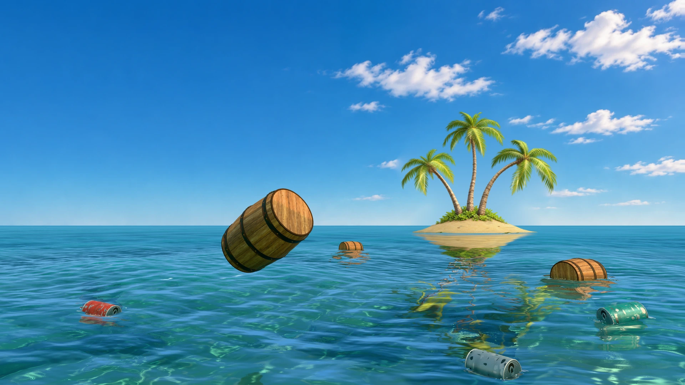

拎起木桶时，可以看清原本浸在水里的桶身和铁箍。

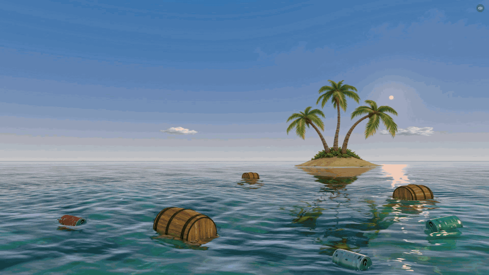

提起、松手、落水。一轮操作只要几秒。

### 看一会儿风浪

近处的短浪叠在缓慢起伏的涌浪上，椰树、天空和日光的倒影也会随水面变形。浪抬起时，能看到浮物浸在水中的一截。把鼠标移到画面下边缘，或在触屏上点一下底边，可以打开昼夜控制，在晨光、白昼、黄昏和夜色之间切换。环境声可从右上角开关。

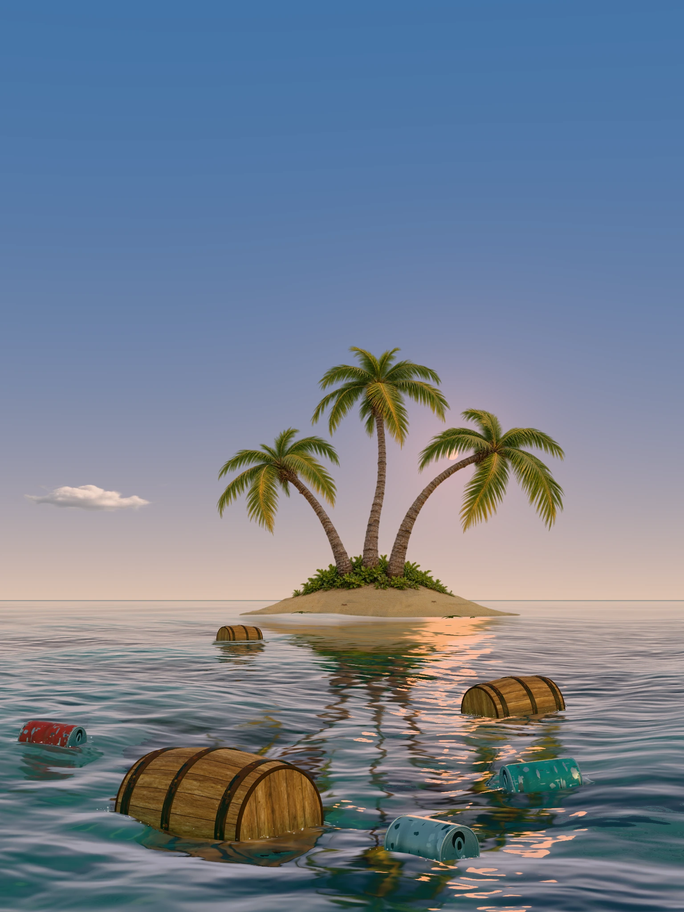

晨光里的椰岛。低处的日光会在浪间拉长，水桶也随水面缓缓升降。

## 气泡过场

点击海鸥带着的木牌，木牌落水，视线下沉。气泡盖住视野时，海面切到浅海的开场视角。气泡声使用素材自带的独立音轨，往返时都走同一段过场。

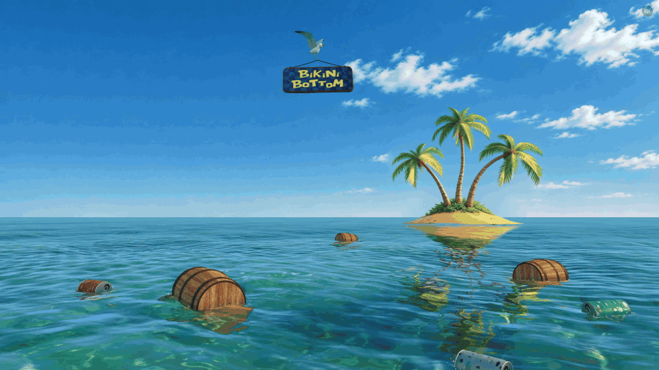

从海鸥飞过到水下见到小镇。这段动图做了轻微加速。

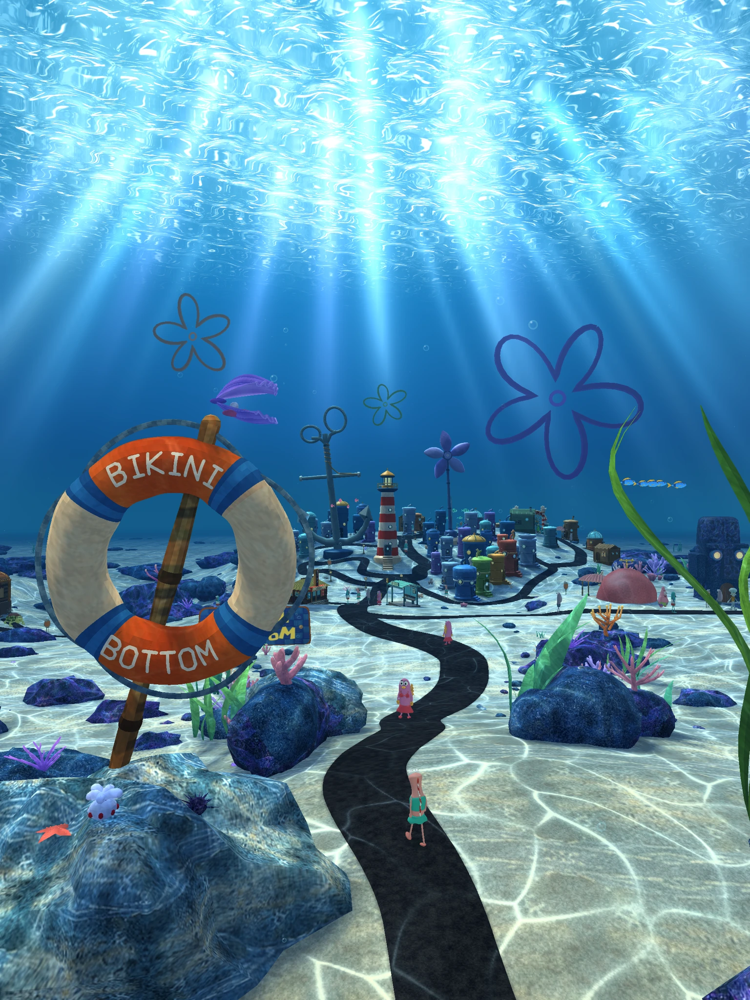

从约 92 米深的位置望向城镇。入口一带有欢迎救生圈、紫色贝壳、珊瑚和落到沙地的光纹。

## 浅海漫游

### 顺着路进镇

拖动画面环顾，用 `WASD` 或方向键游动，`空格` 上浮，`C` 下潜，`Shift` 加速。触屏也可以用画面内的方向控制。右侧深度条可以帮你判断当前高度。合并版里，其他控件在闲置一会儿后会收起，将指针移到屏幕边缘或触碰边缘就能再叫出来。

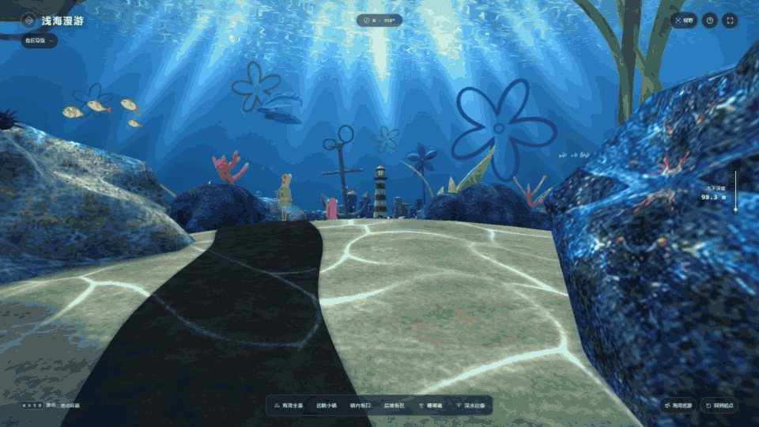

从礁石之间游进镇。途中可以转向、浮高、沉下来，按自己的路线看街景。

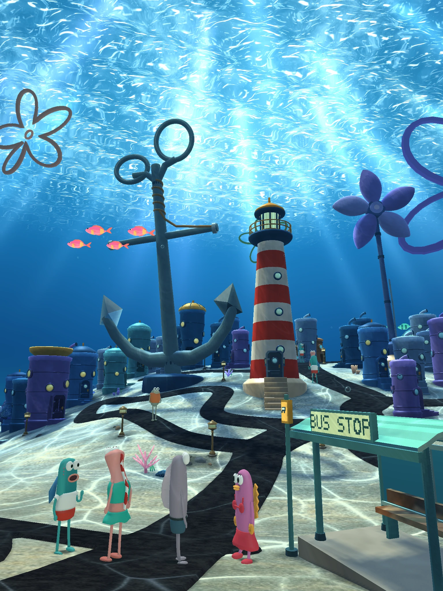

镇内街口。贴近路面游时，可以仰看房屋和穿过水层的光柱。

### 去几处熟悉的地方

沿海螺街找菠萝屋、石像屋和邻居的住处，再继续往蟹堡王、海之霸和湾区住宅游。往外看还有灯塔、锚屋、珊瑚礁和海沟。建筑、角色和珊瑚之间都有可以游进去看的空间。靠近街上，有些角色会走动、转身或挥手。

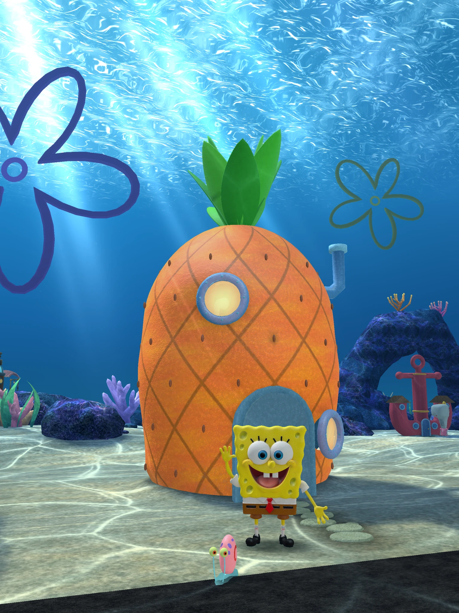

菠萝屋门前。游近一些，可以看到屋门、窗框和站在屋前的海绵宝宝。

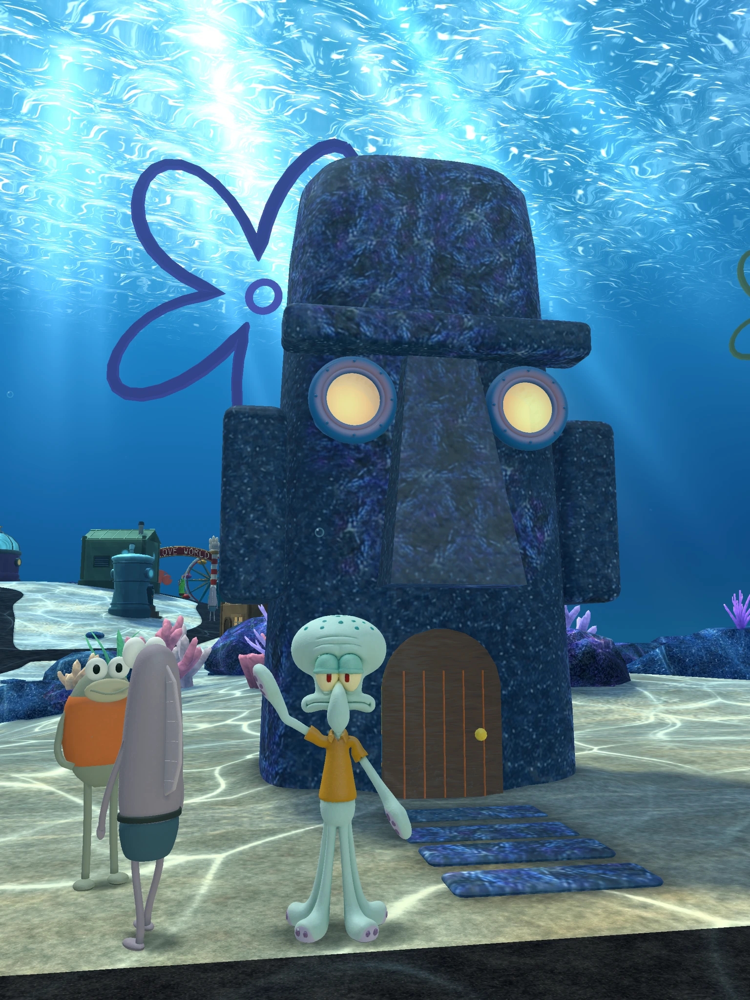

石像屋从巷口就能认出来。可以绕到侧面，再从路面抬头看它的轮廓。

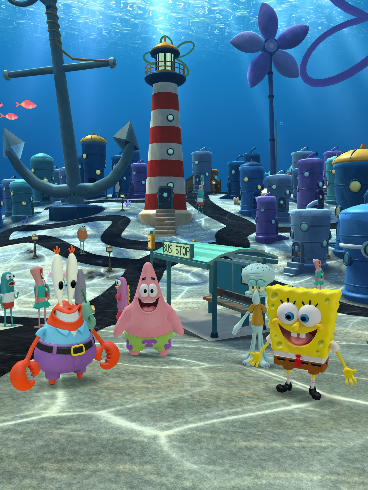

小镇广场。顺路停一会儿，可以观察居民的姿势和动作。

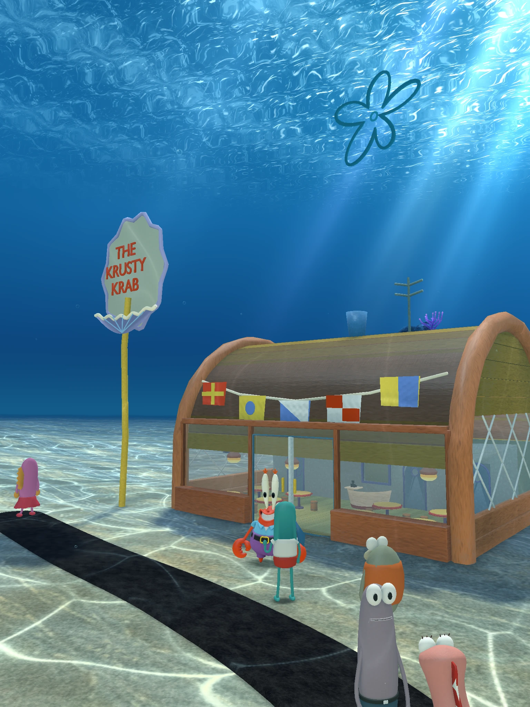

蟹堡王街景。沿街游过去时，可以慢慢看到门面、招牌和周围更大的建筑。

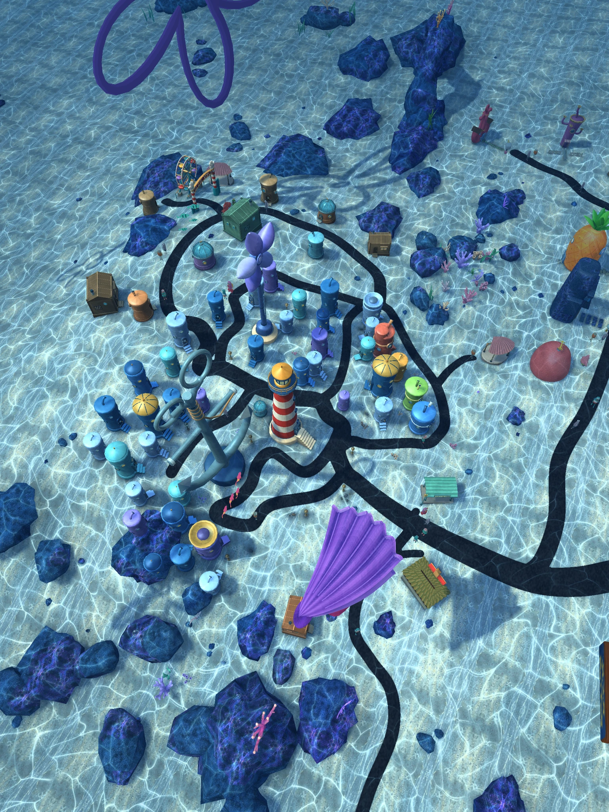

上浮做一次高处远眺，能看清城镇、绕行道路和外围礁石的关系。

打开场景菜单可以直接去指定街区，或者选择「海湾巡游」，让镜头带你绕湾区走一圈。想自己找路线时，随时可以回到自由漫游。

### 回到海面

落水的木牌会进入同一个小镇，从贝壳附近落到镇前的沙地。游到它旁边点一下，就能穿过气泡回海面。想从水里直接上来，也可以一路往上游，到水下 50 米时会触发返程。

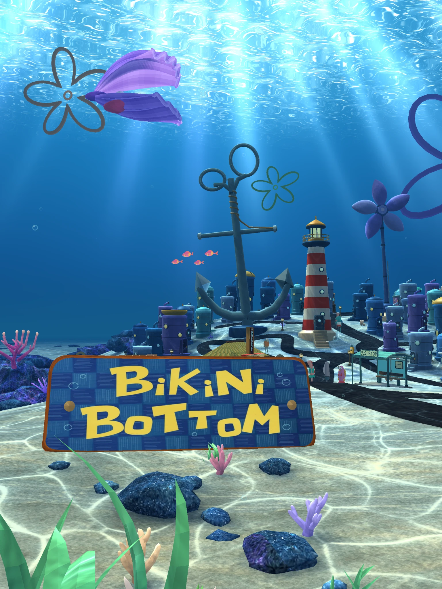

镇前沙地上的木牌，往返两段体验的入口。

## 启动与下载

需要 Node.js 20 或更高版本，以及支持 WebGL 2 的浏览器。解压完整项目后，在项目目录启动本地服务器。

```sh
npm start
```

在浏览器打开 [合并版](http://127.0.0.1:8846/)，也可以直接打开任一独立入口。

| 独立项目 | 可以体验的内容 | 入口 | 独立下载 |
| --- | --- | --- | --- |
| 海面 | 风浪、昼夜、拖拽浮物与携牌飞行的海鸥 | [本地海面](http://127.0.0.1:8846/surface/) · [目录](web/surface/) | [surface.zip](https://github.com/ababanabk022-debug/bikini-bottom-shawn/releases/download/v1.0.1/surface.zip) |
| 气泡过场 | 带透明通道的气泡 WebM、轻量版本与独立音轨 | [本地过场](http://127.0.0.1:8846/transition/) · [目录](web/transition/) | [transition.zip](https://github.com/ababanabk022-debug/bikini-bottom-shawn/releases/download/v1.0.1/transition.zip) |
| 浅海 | 自由游动、街区跳转、海湾巡游，以及建筑与角色模型 | [本地浅海](http://127.0.0.1:8846/underwater/) · [目录](web/underwater/) | [underwater.zip](https://github.com/ababanabk022-debug/bikini-bottom-shawn/releases/download/v1.0.1/underwater.zip) |

三个独立 ZIP 都带运行说明，各自解压后可用静态服务器单独打开。

### 代码怎么组织

合并版共用三个目录里的代码和资源，由 `web/index.html` 调度场景。海面用仓库自带的 Three.js 绘制波浪和倒影，浅海使用 WebGL 2。浅海的 8 个建筑模型和 19 个角色模型装在压缩资源包里，所以文件列表里看不到每个模型单独占一个文件。合并版在后台准备资源，切到海底后会暂停海面的绘制。 [合并入口](web/index.html)

## 许可

- **项目原创代码**采用 GPL-3.0-only。可以使用、修改和商用。向他人分发受该许可覆盖的修改版时，需要沿用 GPLv3，并按许可提供对应源码。 [GPLv3 全文](LICENSE)
- **项目有权授权的原创模型、贴图、文档和其他独立素材**采用 CC BY-NC-SA 4.0。可以非商用地使用和改作，分享改作时沿用同一许可，署名写项目名和来源链接。 [素材授权范围](ASSET-LICENSE.md)
- 这是《海绵宝宝》主题的同人项目。人物、品牌标识和第三方动画、声音等各自适用原有权利。随海面项目附带的 Three.js 继续适用其 MIT 许可。 [Three.js 许可](web/surface/vendor/LICENSE)
